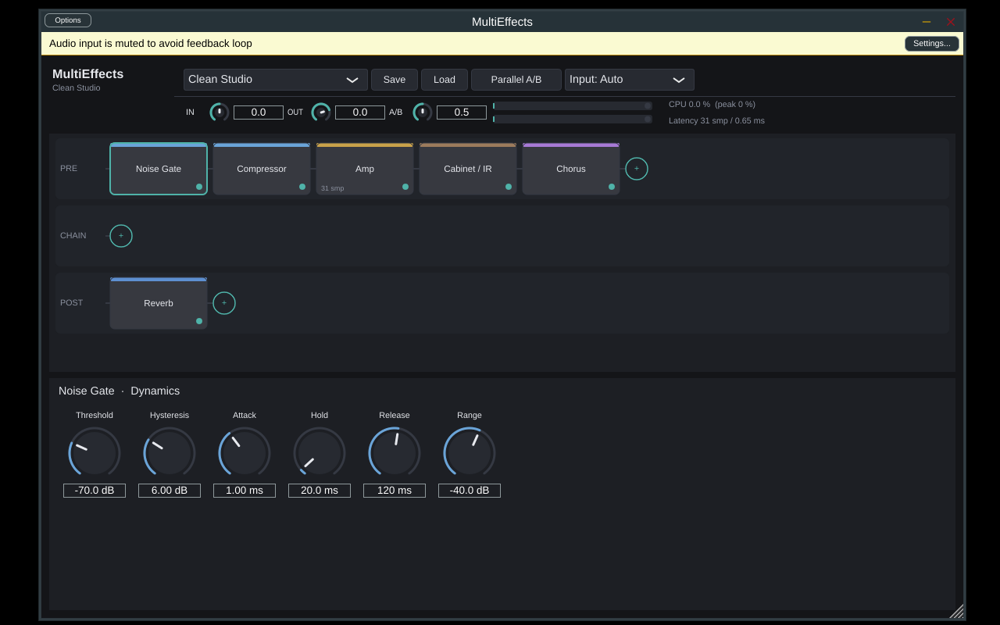

# MFX Claude — 기타 멀티이펙터 소프트웨어 (v0.2.0)

플러그인(AU · VST3 · Standalone)과 향후 전용 하드웨어가 **같은 DSP 엔진**을 공유하는 기타 멀티이펙터입니다.
DSP 코어(`mfx_core`)는 JUCE·OS·Python에 의존하지 않는 C++20 정적 라이브러리입니다.



## 빠른 시작

```bash
# 1) 코어 + 테스트 + 오프라인 렌더러 (의존성 없음)
cmake -S . -B build -G Ninja -DCMAKE_BUILD_TYPE=Release
cmake --build build
./build/mfx_tests                      # 65 tests, ~1 min
./build/mfx_render --list              # 이펙트 목록

# 2) 플러그인 (JUCE 8 자동 다운로드), NAM 지원 포함
cmake -S . -B build-plugin -G Ninja -DCMAKE_BUILD_TYPE=Release \
      -DMFX_BUILD_PLUGIN=ON -DMFX_WITH_NAM=ON
cmake --build build-plugin
```

macOS(Apple Silicon)에서 AU 빌드·Logic 로딩 절차는 [docs/BUILD_GUIDE.md](docs/BUILD_GUIDE.md)를 참고하세요.

## 오프라인 렌더러 (다른 엔진과의 비교용)

```bash
./build/mfx_render -i in.wav -o out.wav --preset presets/factory/02_Crunch_Rhythm.json \
    --block 128 --bench bench.json --analyze-thd 1000
./build/mfx_render -i in.wav -o out.wav --effect custom_drive --set drive=70 --set oversampling=3
./build/mfx_render --describe custom_drive     # 파라미터 명세 JSON
```

`bench.json`에는 처리 시간, 실시간 배수, 최악 블록 부하, 최대 메모리(RSS), 지연, 체인/파라미터, 출력 통계,
(선택) THD·THD+N·배음·비배음 에너지가 기록됩니다. 인터페이스 정의는 [docs/BENCHMARK_PROTOCOL.md](docs/BENCHMARK_PROTOCOL.md).

## 구성

| 경로 | 내용 |
|---|---|
| `src/core` `src/dsp` `src/engine` | DSP 코어, 이펙트 25종, 실시간 엔진 |
| `src/neural` | NAM Amp (NeuralAmpModelerCore, 선택 빌드) |
| `src/plugin` `src/ui` | JUCE 래퍼, UI |
| `apps/` | `mfx_render`, `mfx_modeling_study` |
| `tests/` | C++ 테스트(unit/audio/integration/performance), Python/C++ parity |
| `tools/` | 신호 생성, 분석, 하드웨어 측정, 벤치마크 |
| `research/` | SPICE(ngspice), DDSP(PyTorch), 노브 LUT, 베이스라인 |
| `docs/` | 설계·명세·연구·실험·결정 기록, 완료 보고서 |

## 상태

최신 상태는 **[docs/INTEGRATION_REPORT.md](docs/INTEGRATION_REPORT.md)**(2026-11-24 통합 고도화),
알려진 문제는 [docs/KNOWN_ISSUES.md](docs/KNOWN_ISSUES.md)에 있습니다. 요약:

* C++ 테스트 70개 통과(v0.1의 65개 + 트레일 2, 동시성 2, 진단 1), 오디오 스레드 힙 할당 0회
* ASan/UBSan, TSan 경고 0. Python/C++ parity 통과. VST3(Linux) pluginval strictness 7 + GUI 통과
* Custom Drive 매핑 v2: 참고 프로젝트(Codex)와 같은 하니스로 비교 측정(docs/REFERENCE_PROJECT_COMPARISON.md)
* 플러그인 식별자: **MFX Claude / MfxL / McL1** — Codex "Multi Effects"와 v0.1 "MultiEffects"를 덮어쓰지 않음
* **AU·Logic은 사용자 Mac에서 `scripts/macos_build_install_verify.sh` 실행 전까지 NOT TESTED**
* 실제 아날로그 장비 측정·청취 평가는 없습니다. 아날로그 재현 정확도·청감 우수성은 주장하지 않습니다.

## 라이선스

프로젝트 코드: [LICENSE](LICENSE). 외부 구성요소(JUCE 8 = AGPLv3/상용 이중 라이선스 등)는
[THIRD_PARTY_NOTICES.md](THIRD_PARTY_NOTICES.md)를 반드시 확인하세요.
